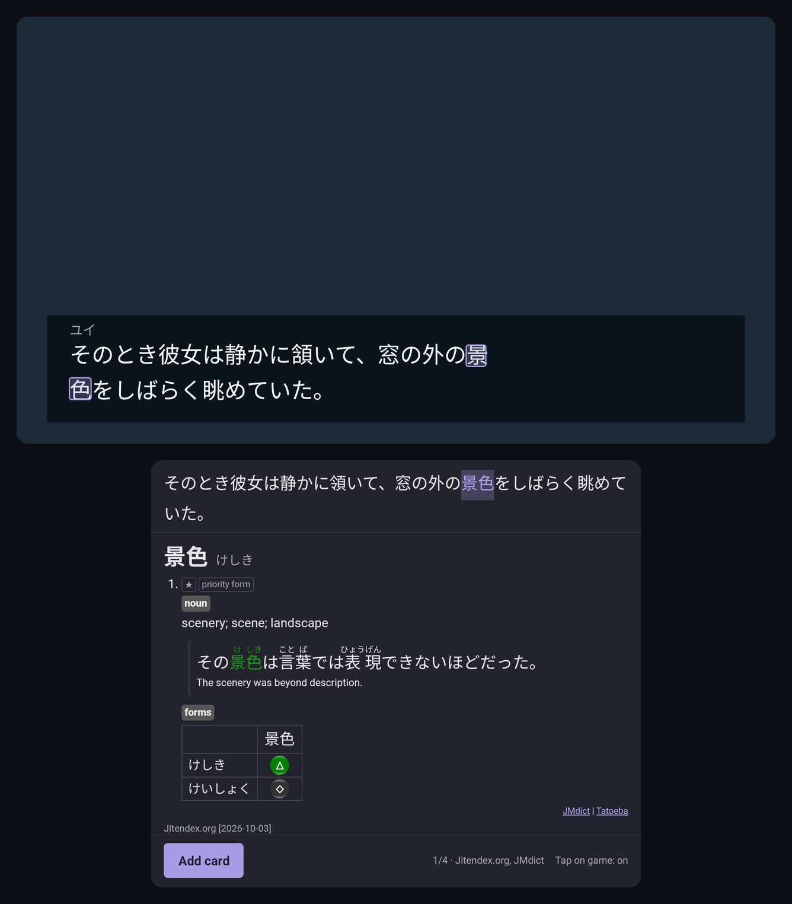
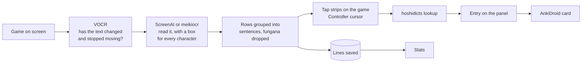

<div align="center">

# LearnFromGames

**Learn Japanese from the games you are already playing.**

Tap a word in a game, or pick it with the controller. Read the entry. Press once for an Anki card with the screenshot.




<sub>The stand-in game from this repo on an emulator laid out like the AYN Thor's two screens. Dictionary: Jitendex.</sub>

</div>

LearnFromGames (LFG) is [GameSentenceMiner](https://github.com/bpwhelan/GameSentenceMiner) for Android handhelds, designed for the AYN Thor first. It sits over any game or emulator, reads the Japanese on screen, and turns it into something you can look up and keep.

> [!WARNING]
> **Nothing here has run on a real handheld yet.** Every part is built and has been run on Android emulators (Android 13 and 15). What only a device can answer is listed under [Not done, or not known](#not-done-or-not-known).

## What it does

- **Reads the game for you.** An accessibility service pictures the screen, notices when new text has stopped moving, and reads it. No screen-recording prompt, no setup per game.
- **Tap a word on the game.** Each line of text becomes tappable where it is drawn. A wrapped sentence is one sentence, and a word cut by the line break is still one word.
- **Or never let go of the controller.** L3 + R3 turns the pad into a text cursor: by word, by line, by character. The game receives nothing until you leave.
- **Uses the second screen.** On a two-screen handheld the entry opens on the screen the game is not on. On one screen it is a popup.
- **One press to Anki.** Cards go to AnkiDroid with the sentence, the word marked, the definition and a picture of the game. Kiku, Lapis and Senren note types are found by themselves; without one, the app makes its own.
- **Sentence audio and moving pictures**, if you switch them on: the game's own voice for the line, with the music around it cut away, and an animated picture of it appearing. A line the game does not speak is read by Android's voice instead.
- **Your dictionaries.** JMdict is fetched at first run; add any Yomitan dictionary zip and it is shown with its own styling.
- **Every line is kept**, so you can mine after the session and see reading time, characters, speed and your streak.

## How it works



Everything runs on the device. The only network use is fetching the readers' model files, JMdict, and Bee's Ultimate Dictionary (from [Rubi](https://github.com/bee-san/Rubi_for_vita)'s latest release) at first run.

## Where it stands

| Stage | What works on the emulator |
| --- | --- |
| Tap, read, mine | First run from a clean install. Background reading. Tap strips, the second-screen panel, the one-screen popup. Add card with the picture. Lines saved. |
| Controller | L3 + R3 lookup mode: word, line and character steps, held repeat, entry change, add, close. |
| Dictionaries and lines | JMdict, then Bee's Ultimate Dictionary from Rubi's latest release, install themselves; the second goes first, once, and stays removed if removed. Add, order and remove Yomitan dictionaries; Rubi's .vjdict files can be added too. Full entry rendering. Cards from a stored line after the session. |
| Sound, then motion | Sentence audio added to a card when the next line appears, trimmed to the voice by Silero VAD. Android's voice for a card without one. Animated WebP of the line appearing. |
| Stats | Reading time, characters, speed and streak over 7 days, 30 days, 12 months or all time, against the period before, and a bar for each day or month. Daily goals for hours and characters: today against each, the days that met them, a goal streak, and a goal line on the chart. Two home screen widgets: today against the goals as rings, and the last seven days as bars ([picture](docs/widgets.png)). On [Rubi](https://github.com/bee-san/Rubi_for_vita)'s reading-time rule. |

### Against real apps

- **PPSSPP 1.20.4** (its Japanese menus; no game was run in it): read, tap
  strips placed, tap lookup and the panel all work. It showed two faults, now
  fixed: a moving background made the first pass read slightly different text
  on every frame, so the screen never counted as still and was never read
  (text now settles when only a character in twenty differs, and is read
  anyway after six seconds of never holding still); and with dozens of pieces
  of text on screen the panel listed them all and pushed the entry off it.
  Still wrong there: icons beside labels are read as stray characters
  ("[1) オーディオ"), and every menu label is saved as a line.
- **Lapis 1.7.0 and Senren 5.1.0**, imported into AnkiDroid from their release
  decks: a card made from the game lands in the right fields of each. Kiku
  2.1.0's fields are checked against the mapping but no card was made in it.
  While cards are going to the app's own note type it looks again each time,
  so one of the three installed later is picked up without "Find again".
- **The release build** on the Android 15 emulator: reading with ScreenAI,
  lookup, the styled entry and a card all work after shrinking. meikiocr was
  seen to load there, not to read.

### Not done, or not known

- The plan's "Prove first" questions that need the device are all still open:
  whether the controller stays with the game after a touch on the Thor's
  bottom screen, AYN firmware and quickly changing overlay windows, AnkiDroid
  answering after a cold start there, and what background reading costs in
  battery and heat. The emulator answered the others (see below).
- No speed or accuracy figures for ScreenAI against meikiocr on a handheld.
- A text hook as a second source of lines (the plan's "after that, if wanted")
  is not built. The intent is for the app to be the texthooker itself, not to
  listen to another one.
- The popup on a one-screen device shows the entry as plain text; full
  rendering is on the panel and in the app.

### How fast it is

`tools/bench.sh` runs the stand-in game through three phases and prints the
app's CPU use and its own step timings (logcat tag `LfgPerf`). These figures
are from the release build on a 4-core x86_64 emulator with software graphics,
at 1080p; they say where the time goes, not what a handheld will show.

| Phase | Before | After |
| --- | --- | --- |
| The same line sitting on screen | 31.5% of a core | 7.6% |
| Advancing a line every 4 s | 48.2% | 40.0% |
| Advancing and looking a word up | 53.1% | 45.2% |
| From text read to text tappable | read + 180 ms for the picture | read + 8 ms |

What changed: a picture identical to the last one is not copied or probed
again (the probe was 110 ms of every look); after ten seconds unchanged the
screen is looked at half as often; the screenshot is copied off the main
thread; and the card's picture is written behind the reading instead of in
front of it. What is left, per look: copying the screenshot out of graphics
memory (40 ms here), the probe on a changing screen (90 ms), and a full
reading per new line (320 ms with ScreenAI). A lookup is 4–60 ms.

<details>
<summary><b>How well it reads</b> (scores on a drawn test set)</summary>

`tools/make_ocr_corpus.py` draws twelve harder screens with their true text
(wrapped sentences, furigana, busy backgrounds, no text box, 720p, letterboxed,
choices, dark-on-light, novel pages, vertical, status text, name plates), and
`tools/score_ocr.py` scores what the readers made of them. These are drawn
screens, not real games.

| Reader | Whole pieces read exactly | Mean character accuracy | Extra pieces |
| --- | --- | --- | --- |
| ScreenAI, rows as read | 11 of 20 | 0.875 | 11 |
| ScreenAI, grouped | 18 of 20 | 0.995 | 0 |
| meikiocr, rows as read | 10 of 20 | 0.873 | 10 |
| meikiocr, grouped | 17 of 20 | 0.992 | 0 |

"Grouped" is what the app does with a reading (`core/Blocks.kt`): rows that
sit like the lines of one text box become one piece, so a wrapped sentence is
one line in the store and on a card, and a word cut by the line break can be
tapped and is marked on both rows; furigana is dropped. What is still wrong:
ScreenAI took 頷 for 領; meikiocr dropped a digit and a comma in status text;
and one case is the corpus's own fault (its vertical punctuation is drawn where
no game puts it). A small kana-only name plate set as close to its line as
furigana, over a kanji, is taken for furigana.

</details>

<details>
<summary><b>Where this differs from the plan</b></summary>

- **What counts as a game.** The plan reads whatever app is in front. In
  testing that put tap strips over Android's file picker and swallowed taps on
  its labels. An app is now read automatically only while it is fullscreen (no
  status or navigation bar on its screen), or if it declares itself a game or
  is a known emulator. Settings › Games has Automatic, Always and Never for each.
- **Pictures of the game.** From Android 14 the service pictures the game's
  own window, so the app's mark and popup are never in a frame. On Android 13
  it pictures the whole screen: reading pauses while a word is marked on the
  game, and text under other windows (a system dialog) is ignored.
- **Note type ties.** Hachidori stops and asks when two supported note types
  hold the same number of notes, or none has any. This app never asks: a tie
  goes to the older note type and an unused one is still used.
- **`cards.payload`** is an extra column: the card's content, so a card made
  without AnkiDroid can be sent later.

</details>

<details>
<summary><b>What the emulator answered from the plan's "Prove first"</b></summary>

- A service is handed real gamepad buttons (not ones injected with `adb shell
  input`), and a D-pad that arrives as an axis reaches a focused overlay
  window. The game sees the shortcut's own buttons; nothing after that.
- bee-san/hoshidicts builds with NDK r29 and needs CMake 3.31. JMdict (528,000
  entries) imports in well under a second on a desktop core.
- screenai_ocr builds with the NDK and reads the test screens exactly as on the
  desktop. On a 4-core x86_64 emulator a 1080p frame takes 115–130 ms.
- VOCR reads a 1080p frame in 20–30 ms on a desktop core.
- AnkiDroid answers while closed, creates the note type and deck, and takes a
  field update on an existing note.
- The accessibility switch survives a reboot and the service rebinds by itself.
- arm64, under `qemu-aarch64`: hoshidicts imports JMdict and answers lookups
  byte for byte as on x86_64; VOCR (its NEON path) reads the test screens the
  same; ScreenAI reads the same characters, with character boxes up to 9 px
  from the x86_64 ones.

</details>

## Install

There are no releases yet. Once a tag is pushed, the release workflow attaches an arm64 APK to a GitHub release, which [Obtainium](https://github.com/ImranR98/Obtainium) can follow. Until then, build it:

## Build

Needs JDK 17, the Android SDK (platform 36), NDK 29.0.14206865, and CMake 3.31
or later on `PATH` (the SDK's own CMake packages are too old for hoshidicts).

```sh
git submodule update --init --recursive
echo "sdk.dir=/path/to/android-sdk" > local.properties
./gradlew :app:assembleDebug        # app/build/outputs/apk/debug/app-debug.apk
./gradlew :app:testDebugUnitTest
```

A release is one shrunk APK per kind of device (about 50 MB for arm64, against
172 MB for the debug build, most of it ONNX Runtime):

```sh
./gradlew :app:assembleRelease      # app/build/outputs/apk/release/app-arm64-v8a-release.apk, app-x86_64-release.apk
```

It is signed with your own key if `keystore.properties` (not kept in git) is
beside `settings.gradle.kts`, and with the debug key otherwise, which installs
but can never be updated by a properly signed build:

```sh
keytool -genkeypair -v -keystore release.jks -alias lfg -keyalg RSA -keysize 4096 -validity 10000
printf 'storeFile=release.jks\nstorePassword=…\nkeyAlias=lfg\nkeyPassword=…\n' > keystore.properties
```

`.github/workflows/release.yml` does the same on GitHub when a tag like
`v0.2.0` is pushed, and attaches the APKs to a release for Obtainium; its
header lists the four secrets it needs. `check.yml` runs the tests and lint on
every push. **Neither workflow has run yet.**

ScreenAI's library is built separately, once, and is not kept in git. Without
it the app still builds and reads with meikiocr.

```sh
ANDROID_NDK=/path/to/ndk/29.0.14206865 tools/build_screenai.sh   # about 8 minutes; fills app/src/main/jniLibs
```

The dictionary and VOCR boundaries also build and run on the build machine:

```sh
cmake -S app/src/main/cpp -B host-build -G Ninja -DCMAKE_BUILD_TYPE=Release
cmake --build host-build
./host-build/lfg_dict_host import JMdict_english.zip dicts
./host-build/lfg_dict_host lookup "dicts/JMdict [2026-11-17]" 見たんだ
gunzip -c app/src/test/resources/screens/dialogue.argb.gz > dialogue.argb
./host-build/lfg_vocr_host app/src/main/assets/vocr/VOCR6.2_N_w8g2.vocr app/src/main/assets/vocr/textspot8_t64n8c16_w8.vtsp dialogue.argb
```

The same tests build for arm64 and run under `qemu-aarch64`:

```sh
cmake -S app/src/main/cpp -B arm64-tests -G Ninja -DCMAKE_BUILD_TYPE=Release \
  -DCMAKE_TOOLCHAIN_FILE=$ANDROID_NDK/build/cmake/android.toolchain.cmake -DANDROID_ABI=arm64-v8a \
  -DANDROID_PLATFORM=android-33 -DANDROID_STL=c++_static -DLFG_HOST_TESTS=ON -DCMAKE_EXE_LINKER_FLAGS=-static
cmake --build arm64-tests
qemu-aarch64 arm64-tests/lfg_dict_host lookup "dicts/JMdict [2026-11-17]" 見たんだ
```

The meikiocr unit tests run the real models when they are in the Hugging Face
cache (`rtr46/meiki.text.detect.v0`, `rtr46/meiki.txt.recognition.v0`) and are
skipped otherwise.

## Trying it without a handheld

```sh
./gradlew :app:assembleDebug :fakegame:assembleDebug
adb install app/build/outputs/apk/debug/app-debug.apk
adb install fakegame/build/outputs/apk/debug/fakegame-debug.apk
```

To score the readers on the corpus (ScreenAI through the host `run_ocr` that
`tools/build_screenai.sh`'s sources also build; meikiocr through the app's own port):

```sh
python3 tools/make_ocr_corpus.py corpus
LFG_CORPUS=$PWD/corpus ./gradlew :app:testDebugUnitTest --tests '*OcrCorpusReport*'
tools/score_ocr.py corpus --show
```

`fakegame` is a dialogue box whose text types itself out and advances on a tap
or a button, with a tone as its "voice". Started with `--ez music true` it
plays music throughout instead, and speaks `voice.s16le` (16 kHz, 16-bit, mono;
the tests' own is `app/src/test/resources/sound/voice.s16le`) from its external
files folder on two lines in three, which is how voice trimming is checked.
`tools/virtual_pad.py` plays a gamepad on the emulator. Do not use `uiautomator dump` while testing: it suspends
accessibility services while it runs.

## Layout

- `app/src/main/cpp` — `lfg_dict` (hoshidicts to JSON), `lfg_vocr`, `lfg_screenai`, `lfg_webp`, `lfg_jni`, and host tests
- `app/src/main/kotlin/io/github/beesan/lfg`
  - `core` — the line record, grouping rows into text blocks, tap hit-testing, settle detection, the text cursor, reading-time rules
  - `ocr` — VOCR, meikiocr, ScreenAI, and their model downloads
  - `dict` — the engine's JNI face, entries as text and as HTML, dictionary management
  - `lookup` — lookup from a character, by touch or controller
  - `anki` — note type detection and field filling, AnkiDroid calls, cards, sentence audio
  - `data` — the Room store
  - `capture` — the accessibility service, the reading pipeline, sound capture
  - `overlay` — tap strips, mark, popup, panel, controller input
  - `ui` — set-up, lines, settings, stats
  - `widget` — the home screen widgets
- `fakegame` — the stand-in game
- `third_party/hoshidicts`, `third_party/libwebp` — submodules; `third_party/vocr` — VOCR's runtime, copied
- `tools` — `build_screenai.sh`, `make_test_screens.py`, `make_ocr_corpus.py`, `score_ocr.py`, `bench.sh`, `virtual_pad.py`

## Licences

The app is GPL-3.0-or-later, as hoshidicts is.

- VOCR's runtime (bee-san/vita-vn-ocr) is GPL-3.0-or-later. **Its weights, in
  `app/src/main/assets/vocr`, are for non-commercial use only**; the attribution
  files beside them say why.
- meikiocr (rtr46): code Apache-2.0, weights LGPL-3.0. The weights are
  downloaded at first run.
- screenai_ocr (AuroraWright) is MPL-2.0. The model files it runs are Google's,
  published for Chromium; no licence for them was found, so the app downloads
  them from Chromium's package store and never ships them.
- libwebp is BSD-3-Clause. AnkiDroid's API is LGPL-3.0. ONNX Runtime is MIT.
- Silero VAD is MIT. Its model ships in `app/src/main/assets/vad`.

## Thanks

LFG stands on [GameSentenceMiner](https://github.com/bpwhelan/GameSentenceMiner), [hoshidicts](https://github.com/bee-san/hoshidicts), [VOCR](https://github.com/bee-san/vita-vn-ocr), [meikiocr](https://github.com/rtr46/meikiocr), [screenai_ocr](https://github.com/AuroraWright/screenai_ocr), [AnkiDroid](https://github.com/ankidroid/Anki-Android), [Silero VAD](https://github.com/snakers4/silero-vad), [Jitendex](https://jitendex.org) and JMdict, and on the Kiku, Lapis and Senren note types.

The plan and screen designs this was built from: <https://claude.ai/artifact/PahaxprErjPmLGocbz6pPW>
